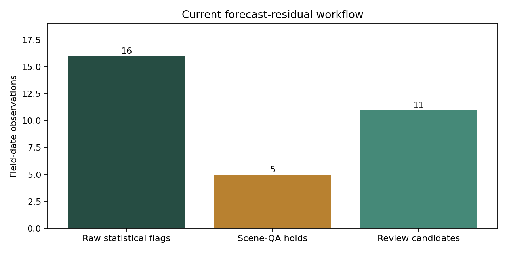

# AgriLens — Dust or Drought?

**Egyptian Nile Delta satellite vegetation monitoring, observation-quality screening, and field-review prioritization.**

AgriLens is a proof of concept for the **2026 Arab Youth Space Hackathon / Satellite 813 challenge**. It combines real Sentinel-2 imagery and NASA EMIT hyperspectral observations to help identify unusual vegetation changes and determine which observations should be checked for atmospheric contamination or potential crop concerns **before irrigation decisions are changed**.

**Scientific boundary:** These are statistical and contextual screens, **not independently validated dust/drought damage diagnoses**. There are **zero verified dust- or drought-induced crop-damage labels**, and the software must not be used to prescribe irrigation automatically.

## Submission entry point

**Official theme: Precision Agriculture & Crop Intelligence.**

Start with **[AgriLens_PoC.ipynb](AgriLens_PoC.ipynb)**. It reads the committed Egyptian sample, runs the current model, verifies the **16 / 5 / 11** result, generates a chart and GeoJSON, and plots the real EMIT spectra. It needs no data downloads, keys or online services after dependency installation. [Pitch PDF](presentation/AgriLens_PoC_Pitch.pdf). [Submission checklist](SUBMISSION_CHECKLIST.md).

### User and business use case
The intended user is an agronomist or irrigation manager supporting farms or cooperatives. The immediate decision is **which field observation to inspect first**. The user checks the field history and imagery, requests field evidence, then decides whether management action is justified. A proposed business model is a monitoring subscription sold to cooperatives or agricultural advisory services. Pricing, willingness to pay and any water or yield benefit still require pilot evidence.

### Why Egypt for a Jordan-based team?
The committed study area has a usable Sentinel-2 time series and actual local EMIT spectra. This supports a reproducible demonstration on real observations within the available time. It does not establish that Jordan has no hyperspectral coverage. We describe all results as Egyptian, and require a new local data audit, agronomic references and out-of-region evaluation before a Jordan pilot. EMIT provides exploratory hyperspectral evidence and is not a temporal input to the current anomaly forecaster.

### Verified environment and notebook commands
Test environment: **CPython 3.12.14 on Linux**. A clean virtual environment installed the pinned requirements successfully, passed `pip check`, and reproduced the main notebook results. `requirements.txt` pins the notebook/model dependencies. Windows commands below assume Python 3.12 is installed. Windows itself has not been tested in this environment.

```powershell
py -3.12 -m venv .venv
.\.venv\Scripts\python.exe -m pip install -r requirements.txt
.\.venv\Scripts\python.exe -m ipykernel install --user --name agrilens --display-name "AgriLens Python 3.12"
.\.venv\Scripts\python.exe -m nbconvert --to notebook --execute AgriLens_PoC.ipynb --ExecutePreprocessor.kernel_name=agrilens --ExecutePreprocessor.timeout=180 --output AgriLens_PoC.executed.ipynb
.\.venv\Scripts\python.exe -m pytest -q tests/test_ndvi_anomaly_detection.py
```

Cross-platform (inside your activated environment):

```bash
python -m pip install -r requirements.txt
python -m ipykernel install --user --name agrilens --display-name "AgriLens Python 3.12"
python -m nbconvert --to notebook --execute AgriLens_PoC.ipynb --ExecutePreprocessor.kernel_name=agrilens --ExecutePreprocessor.timeout=180 --output AgriLens_PoC.executed.ipynb
```

Alternatively open the notebook in VS Code with the Jupyter extension, select the installed environment, restart the kernel and run all cells. New output is written under `output/notebook_run/`. Frozen example results remain under `output/ndvi_anomaly_v1/`.

**Verification scope:** all three notebooks passed sequential cell execution in separate, fresh in-process IPython kernels. The standard Jupyter/nbconvert transport could not run in the build environment because local socket binding is prohibited. A normal Jupyter kernel run on a developer machine or GitHub Actions remains an explicit final verification step. See `NOTEBOOK_EXECUTION_REPORT.json`. This is not a claim of automatic organiser acceptance.



### Sources and licences
Contains modified Copernicus Sentinel data (2025), NASA EMIT reflectance, FTW predicted field boundaries and Open-Meteo/CAMS context. The detailed product names, licence terms, source links and modifications are in [DATA_SOURCES_AND_ATTRIBUTION.md](DATA_SOURCES_AND_ATTRIBUTION.md). These sources do not provide independent dust/drought damage labels.

## Open the interactive demonstration

Open [`docs/index.html`](docs/index.html) locally in a browser. For a published demo, enable GitHub Pages from the repository's `main` branch and `/docs` folder. The HTML is self-contained with embedded imagery and demonstration data.

**The demo reports Rama's independently packaged validation workflow**, not Rand's newer forecast-residual model. Do not combine their flags as one model metric.

## Data and geographic validation

| Component | Actual research coverage |
| --- | --- |
| Region | Nile Delta, Egypt, approximately 3 × 3 km, center ~30.6300° N, 30.2500° E |
| Sentinel-2 L2A | 707,580 pixel-date observations, 34 reported dates, March–September 2025 |
| Audited field-date table | 615 observations, 20 fields, 33 dates |
| Fixed geographic partitions | 9 training / 6 validation / 5 held-out test fields |
| EMIT reflectance | June 15, 2025; 14 usable fields, 232 complete wavelength bands, 3,248 field-wavelength rows |
| Corresponding Sentinel-2 observation | June 16, 2025 |

The 34-vs-33 acquisition-date difference is explained by masked/unusable scene coverage and should remain auditable rather than forcing counts to match. The scene on March 6 is absent from the audited 615-row field table.

EMIT is a **research stand-in** for Satellite 813-style hyperspectral analysis, **not data acquired by Satellite 813**. The six fields without usable EMIT spectra were excluded by source quality flags; the training split has only 3 usable EMIT fields out of 9, which creates important selection bias.

## Two intentionally distinct anomaly workflows

| Property | Rama validation & Nour demo | Rand modeling experiment (this release) |
| --- | --- | --- |
| Signal | Deviation from prior-three-observation median | One-step forecast lower-tail residual |
| Input | 615 audited field-date rows | 615 audited rows, 595 temporal pairs |
| Flag definition | Two-sided (positive and negative) | Negative observed-minus-expected residual only |
| Statistical flags | **36** | **16** |
| Scene-quality holds | **13** suspected 17-May scene artefacts | **5** model flags held by scene QA on 17 May |
| Remaining items | **23** non-scene review observations: **14 positive, 9 negative** | **11** quality-screened review candidates |
| Maps | Validation GeoJSON | Raw 16-feature and screened 11-feature GeoJSON exports |

**Do not interpret 23 versus 11 as competing performance figures**; thresholds, forecasts, and the type of anomaly differ. Neither result measures dust/drought classification accuracy. Scene-quality designations are **suspected artefacts requiring image review**, not proven false positives.

### Forecast metrics (Rand's current run)

Using the audited 9/6/5 geographic partition and 152 one-step held-out test pairs:

| Test method | MAE | RMSE |
| --- | ---: | ---: |
| Persistence | **0.029575** | 0.043602 |
| Ridge (alpha 1.0, chosen on validation) | 0.031036 | **0.040376** |

The Ridge model was selected on validation; persistence achieved lower test MAE. The **separate** 37-pair historical benchmark recorded persistence MAE 0.02752 and Ridge MAE 0.03555. Do not substitute one experiment's scores for the other.

The current version includes lagged modeled deep-layer moisture in addition to lagged NDMI and modeled dust; this alters the experimental flag count from the earlier 15-flag run to **16**. Environmental variables are **modeled regional context, not field measurements or cause labels**.

## Repository layout

```text
AgriLens_GitHub_Ready_FINAL/
├── README.md
├── CHANGELOG_FINAL.md
├── RELEASE_VERIFICATION.json
├── RELEASE_SHA256_manifest.csv
├── run_ndvi_modeling.ps1                 # reproducible Windows entrypoint
├── requirements-modeling.txt
├── scripts/ndvi_anomaly_detection.py    # corrected modeling module v1.2
├── tests/test_ndvi_anomaly_detection.py  # 13 regression tests, synthetic fixtures
├── docs/index.html                      # Nour dashboard, corrected labels
├── docs/modeling/                     # updated and preserved original notes
├── validation/                        # Rama's final original validation deliverables
├── output/ndvi_anomaly_v1/            # new real-data model outputs, scene QA & map exports
├── 01_Sentinel2_original/             # original Sentinel-2 Parquet and audit material
├── 02_Field_Date_615/                 # audited and derived field-date data
├── 03_EMIT_hyperspectral/             # actual EMIT field-level spectra
├── 04_NDVI_forecasting/
├── 05_Figures/
├── 06_Audits/
├── 06_Documentation/
├── 07_Retrospective_NOT_FOR_MODEL/    # intentionally excluded from predictive features
├── 08_Reproduce/
├── 09_Notebooks/
└── 10_Metadata/
```

The consolidated scientific datasets and Rama's validation package are preserved; original package hashes are retained separately. Derived modeling results are added under `output/ndvi_anomaly_v1`.

## Run locally (Windows PowerShell)

These commands assume you have extracted the ZIP and opened PowerShell at its **root**:

```powershell
python -m pip install -r requirements-modeling.txt
python -m pytest -q tests/test_ndvi_anomaly_detection.py
powershell -ExecutionPolicy Bypass -File .\run_ndvi_modeling.ps1
```

Or run the equivalent cross-platform command, from the repository root:

```bash
python scripts/ndvi_anomaly_detection.py --input 02_Field_Date_615/agrilens_real_field_date_QA_gated_615.csv --repo-root . --output-dir output/ndvi_anomaly_v1 --scene-qa validation/results/date_scene_QA.csv --coordinate-reference validation/results/field_geography.csv
```

Always verify in `output/ndvi_anomaly_v1/data_audit.json` that the split source is `field_split`, the training/validation/test groups contain 9/6/5 fields, and the input SHA-256 is correct. Output paths and run timestamps change on reproduction. Use the pinned requirements.txt environment. The submission notebook checks the expected counts and fails if they change.

### Model outputs

- `field_date_ndvi_anomaly_results.csv`: all 595 scored rows with model, QA and mapping fields.
- `all_split_anomaly_flags.csv`: all **raw** statistical flags (16 in the packaged run).
- `scene_qa_held_alerts.csv`: **5** raw model flags held for suspected image-quality effects.
- `quality_screened_inspection_queue.csv`: **11** remaining review candidates, not verified damage.
- `agrilens_spatial_alerts.geojson` / `agrilens_screened_spatial_alerts.geojson`: **16** and **11** audited-centroid Point features respectively.
- `forecast_metrics.csv`: distinct geographic training OOF, validation, held-out-test scores.
- `threshold_calibration_residuals.csv`: training-only field-group OOF residuals and folds.
- `data_audit.json`, `model_run_manifest.json`, `MODELING_REPORT.md`, figures: run provenance and interpretation.

The model **does not silently remove flagged observations**. The quality hold affects only the *review candidate* status. The scene-QA assessment is a **retrospective validation overlay** that should not be advertised as an operational real-time detector.

## Validation and limitations

Regression suite: **13 synthetic-fixture tests passed** during release assembly. They cover geographic isolation, historical split-column conflicts, training-only threshold calibration, look-ahead invariance, scene-quality labeling, audited-coordinate joins, and spatial serialization. This is software verification rather than agronomic ground truth.

The dashboard was checked at desktop and mobile sizes in a Chromium smoke test; it produced no browser JavaScript exceptions and showed 23 non-scene review rows and 20 selectable fields. Its embedded data is from Rama's documented validation package.

Known limitations: regional dust/AOD and modeled deep-soil moisture lack field-level causal specificity; irrigated water delivery is unmeasured; only one season and small AOI are available; cloudy acquisitions and uneven EMIT retention constrain inference. Never conflate statistical flags, suspected scene artefacts, actual crop damage, or irrigation recommendations.

```


## Team

**Maya** — data acquisition, quality control, releases. **Rand** — NDVI anomaly modeling. **Rama** — validation and geographic splits. **Nour** — interactive demonstration and figures. **Omar** — documentation and presentation.

**AgriLens: Detect the change. Investigate the cause. Check before irrigating.**
